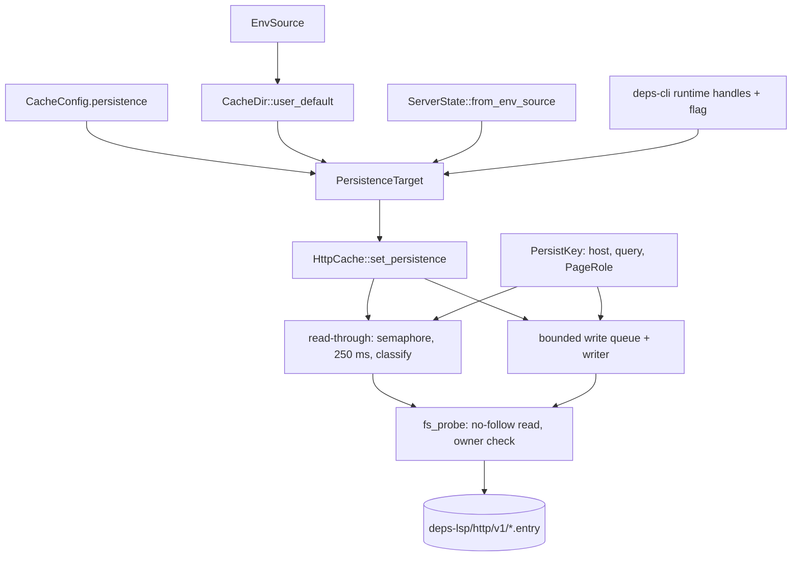

---
aliases:
  - Disk-Persistent Registry Cache Plan
tags:
  - sdd
  - plan
  - caching
  - performance
created: 2026-11-24
status: draft
related:
  - "[[spec]]"
  - "[[tasks]]"
  - "[[constitution]]"
---

# Technical Plan: Disk-Persistent Registry Cache

> [!info] References
> **Spec**: [[spec]]
> **Issue**: #700
> **Delivery**: 3 stacked PRs (A, B, C), opened together, merged back to back

## 1. Architecture

### Approach

Add an opt-out disk tier beneath `HttpCache`'s in-memory `DashMap`, inside `deps-core` only, with std + `serde_json` + `fs_probe` (no new dependency).

- **Read**: lazy read-through on an in-memory miss for an eligible key (`get_cached_via`, before the network fetch). The read runs in `spawn_blocking` behind an 8-permit semaphore, bounded by 250 ms; while the tier is `Opening` the read awaits the transition under the same bound (never opens eagerly: 356 `ServerState::new()` sites read the real `HOME`).
- **Decode and classify**: an entry becomes `Fresh`, `Revalidate`, `Expired` or `FromFuture` from its file mtime (last validation). `Fresh` is served with no request; `Revalidate` joins the existing cached branch (conditional request online, served offline). The promoted in-memory value records `EntryOrigin::Restored { validated_at }`; the window applies only to such entries.
- **Write**: write-behind from `store_entry` (200) and from a 304 on an eligible key through a bounded mpsc queue (256 ops, 16 MiB) and one lazily spawned writer applying ops via `spawn_blocking` + `fs_probe`. A 304 enqueues `Validated` (restamp) or a full `Put` when the header does not match.
- **Concurrency**: per-key atomic rename; the mtime of a file always equals the `validated_at` of the op that last wrote or restamped it, and an op older than the mtime is dropped.
- **Defaults**: `CachePersistence::default() == Disk`, resolved once in `ServerState::from_env_source` and in deps-cli `build_runtime_handles`; `HttpCache::new()` stays `Memory`.

### Component Diagram



### Key Design Decisions

| Decision | Choice | Rationale | Alternatives Considered |
|----------|--------|-----------|-------------------------|
| Freshness | R2: 10-min window from last validation, restored entries only | Anonymous 304 spends GitHub quota (live-confirmed); only a window saves requests | R1 always revalidate (zero request savings) |
| Stamp | File mtime = last validation, restamped on 304 | One stat gives age; survives restart; prune order = least recently validated | Header `fetched_at` (not restampable without rewrite) |
| Backend | One file per entry, magic + version + JSON header + body | No lock, no new dependency, torn-read safe | `redb`/`fjall` (process lock breaks multi-window), `sled`, `rusqlite`, `cacache` |
| Concurrency | Atomic rename, newest validation wins | Simple, NFS-safe | `File::lock` (hangs on NFS/SMB), single snapshot file (lost updates) |
| Eligibility | Typed `PersistKey` over closed `PersistableHost` and `PersistableQueryKey` | No path- or query-borne token can reach disk; admits GitHub tags/compare/releases and gitlab.com | `RedactedUrl` equality (rejects every query URL) |
| Pagination | `PageRole::{ListingPage, Standalone}` declared by the caller; page-1 anchoring for `ListingPage` only | Stops mixed-age pages dropping an existing tag; compare probes stay fresh | Sibling `Remove` (misses another process's late put), URL inference |
| Directory trust | Probe uid from `temp_dir()`; root ownership only; owned `$HOME` for creation; per-file owner check | Never creates foreign-owned dirs under `sudo`/containers; planted files cannot be owned by us | Mode check on root (breaks umask-002 homes), gid exception (macOS inherits parent gid) |
| Default wiring | Resolve once in `ServerState::from_env_source`; `apply_resolved_config` only toggles | Default-on holds without `initializationOptions`; env seam intact | Resolve in `apply_resolved_config` (never runs without options) |
| Open timing | Lazy, background `Opening` state; reads wait up to 250 ms | First request wave after restart must hit disk (SC-001) | Non-waiting open (whole first wave misses), eager open (writes real `~/.cache` in tests) |
| Durability | No `sync_all` knob in PR-A | Measure first on macOS (`F_FULLFSYNC`) | `Durability::{Synced, Unsynced}` up front |
| Test seam | `#[cfg(test)]` loopback admission in deps-core | No `test-util` surface growth | `feature = "test-util"` |

## 2. Project Structure

```
crates/deps-core/src/
├── cache/
│   ├── mod.rs                # HttpCache: set_persistence, flush_persistence, persistence_target (test-util)
│   ├── fetch.rs              # read-through + restamp hooks
│   ├── store.rs              # store_entry enqueue
│   ├── response.rs           # CachedResponse.origin
│   ├── persist/
│   │   ├── mod.rs            # DiskTier state machine, writer, queue, breaker, stale_on_disk
│   │   ├── key.rs            # PersistKey, PersistableHost, PersistableQueryKey, PageNumber, PageRole
│   │   ├── freshness.rs      # ValidatedAt, DiskFreshness, classify, classify_restored
│   │   ├── format.rs         # PersistedEntry, EntryFingerprint, DecodeError, fnv1a64
│   │   └── dir.rs            # CacheDir, CacheDirEnvVar, open + ownership logic, prune
│   └── tests/                # persistence integration + two-process tests
├── fs_probe.rs               # AtomicWrite, FileMode, read_capped_no_follow_with_metadata, open_for_restamp
├── policy_config.rs          # CachePersistence, CacheConfig.persistence
├── github.rs                 # PageRole declarations (tags listing, releases, compare)
crates/deps-gitlab-ci/src/    # PageRole declarations (tags, releases)
crates/deps-lsp/src/          # document/state.rs (S1 wiring), server.rs (toggle, shutdown flush)
crates/deps-cli/src/          # cli.rs (--cache-persistence), main.rs (flush)
crates/github-action/         # entrypoint.sh, tests/entrypoint_test.sh
.github/workflows/ci.yml      # XDG_CACHE_HOME guard
```

## 3. Data Model

```rust
pub enum CachePersistence { Memory, #[default] Disk }          // serde lowercase, deny unknown
pub enum PersistenceTarget { Memory, Disk(CacheDir) }
pub struct CacheDir(PathBuf);                                   // absolute only, no Deserialize

pub enum PageRole { ListingPage, Standalone }
pub struct PageNumber(NonZeroU32);
pub struct ValidatedAt(SystemTime);                             // from the mtime of the same handle
pub enum DiskFreshness { Fresh, Revalidate, Expired, FromFuture }
pub enum EntryOrigin { Network, Restored { validated_at: ValidatedAt } }   // private field

pub struct EntryFingerprint { etag: Option<String>, last_modified: Option<String>,
                              accept: String, body_len: u64, body_fnv1a64: u64 }
enum DiskOp { Put { key, entry, validated_at },
              Validated { key, entry, validators: EntryFingerprint, validated_at },
              Remove { key } }
enum DiskTierState { Unopened, Opening, Ready(Store), Unavailable(DiskTierError) }
enum DiskTierError { NoCacheDir, CreateFailed, InsecureDirectory, ProbeFailed, Io }
enum WriteFailure { Persistent, Transient }
enum FileMode { PreserveTarget, OwnerOnly }
struct ProbeUid(u32);                                           // Unix only
const RESTORED_FRESHNESS_WINDOW: Duration = Duration::from_mins(10);
const MAX_PERSISTED_AGE: Duration = Duration::from_hours(168);
```

`PersistableHost` (closed): api.github.com, gitlab.com, index.crates.io, crates.io, registry.npmjs.org, pypi.org, proxy.golang.org, rubygems.org, pub.dev, repo1.maven.org, dl.google.com, plugins.gradle.org, repo.packagist.org, api.nuget.org, jsr.io, api.jsr.io. The POST-only hosts api.osv.dev and api.deps.dev are excluded: their responses depend on the request body and their GETs never reach `HttpCache` (#2141). The deps-engine `persist_hosts` test pins the list against each crate's `DEFAULT_REGISTRY_BASES` (#2140). `PersistableQueryKey` (closed): `Page`, `PerPage`, `OrderBy`, `Sort`.

**File layout**: `<cache root>/deps-lsp/http/v1/<fnv1a64(url) hex>.entry`; root is `$XDG_CACHE_HOME` (absolute) or `$HOME/.cache` on Linux and other Unix, `$HOME/Library/Caches` on macOS (`XDG_CACHE_HOME` is not honored there), `%LOCALAPPDATA%` on Windows. Header JSON uses `deny_unknown_fields`; the format version is part of the directory name.

### Migrations

None. Older binaries ignore the directory. `v2` never deletes `v1`; stale `vN` directories and `<cache>/deps-lsp/` are safe to delete.

## 4. API Design

Public additions to `deps-core` (additive only; `CachedResponse` and `CacheConfig` are `#[non_exhaustive]`, no new variants on existing exhaustive enums):

| Item | Description |
|------|-------------|
| `HttpCache::set_persistence(&self, PersistenceTarget)` | Live toggle, no I/O on the caller |
| `HttpCache::flush_persistence(&self, Duration) -> FlushOutcome` | Async; `Drained`, `TimedOut`, `Inactive` |
| `HttpCache::persistence_target()` | `#[cfg(feature = "test-util")] #[doc(hidden)] pub` test accessor |
| `PersistenceTarget::from_config(CachePersistence, &impl EnvSource)` | Resolves directory; `Memory` plus one warn on failure; never fails |
| `CacheDir::user_default(&impl EnvSource) -> Result<CacheDir, NoCacheDir>` | Reads a private closed `CacheDirEnvVar { XdgCacheHome, Home, LocalAppData }` through the injected env |
| `CachePersistence`, `CacheConfig.persistence` | Config surface |
| Cache request `page_role: Option<PageRole>` | Declared by callers of `page=` URLs (github.rs, deps-gitlab-ci); `None` plus a `page` key means not persisted |

deps-cli: `--cache-persistence <memory|disk>` on `check` and `update`, a CLI-local `clap::ValueEnum` mapped to `CachePersistence` by an exhaustive `From` (deps-core stays clap-free); overrides config; no env vars.

## 5. Integration Points

| System | Direction | Protocol | Notes |
|--------|-----------|----------|-------|
| OS cache directory | read/write | std fs | Owner-checked, 0700/0600 |
| Registry transports | outbound | HTTPS | Revalidation reuses the Baseline transport, so the preflight and connect-time SSRF guards apply again |
| deps-lsp `ConfigSideEffects` | in | LSP config | Gains `persistence: CachePersistence` |
| GitHub Action container | in | CLI flag | `--cache-persistence memory` (takes effect with the next image release; `action.yml` pins a digest) |

## 6. Security

- **Eligibility** is a type-level rule (FR-001, FR-008, FR-009); `PersistKey::new` matches tier and auth exhaustively with no `_` arm and never panics.
- **No credential, digest or token on disk**; credentialed requests (including `GITHUB_TOKEN`) are never persisted.
- **Directory trust** per FR-014: probe uid from `temp_dir()` (root untouched), root ownership only, creation only under an owned `$HOME`, strict components, per-file owner check through the same handle, `O_NOFOLLOW | O_NONBLOCK`, writes refuse symlinked targets, temp files `create_new`.
- **Restamp integrity**: stat, header check and `set_modified` through one `open_for_restamp` handle (write access, no truncate, `O_NOFOLLOW`; on Windows the open uses `FILE_FLAG_OPEN_REPARSE_POINT` and refuses a symlink or junction through `file_type().is_symlink()` on the handle, #2147).
- **Residual risk**: a co-group user can delete or rename our directory (DoS to memory), never forge an entry; documented.
- Windows: per-user ACL of `%LOCALAPPDATA%`; components verified as directory and not a reparse point; uid and owner check skipped by design: a permanent limit with no owner/DACL verification, documented in the rustdoc of `CacheDir::open` (#2146, #2148); the `fs_probe` reparse race is closed in #2147.

## 7. Testing Strategy

| Level | Framework | What to Test | Coverage Target |
|-------|-----------|-------------|-----------------|
| Unit | nextest | `classify` boundaries (0, W-1 s, W, 7 days, +61 s), `classify_restored`, `PersistKey` table, `sibling_page` query order, format round-trip and every `DecodeError`, `CacheDir::user_default` env table, `CachePersistence` defaults and rejection | All new modules |
| Property | proptest | `decode` and `PersistKey::new` never panic on arbitrary input | Both |
| Integration | mockito + tempdir, `#[cfg(test)]` loopback | Restart inside window (0 hits), after window (1 conditional request, 304 restamps mtime), offline restart, `Accept` mismatch, tiers never on disk, `Disabled` mode, queue overflow, read timeout, open-in-progress wait, breaker (transient errors not counted), dropped-Put then 304 (full write, no restamp), stale-op drop, `stale_on_disk`, page-1 anchor and `Standalone` probe | Key paths |
| Multi-process | re-spawned `current_exe` + `--exact` + role env var | Two children, N reads and writes, zero decode failures; torn-read check | Required |
| Unix-only | tempdir HOME via fake env | Missing root with owned HOME created 0700; parent not HOME to memory; foreign-owned root (probe-uid test seam) to memory; planted g+w file discarded; read-only root; FIFO planted | Required |
| Windows | CI shards | Rename over a file another handle holds open succeeds | Required |
| deps-lsp | nextest | No `initializationOptions` resolves `Disk(<tmp>/.cache/deps-lsp/http/v1)` (macOS path differs); `didChangeConfiguration` `"memory"` flips to `Memory`; bad value rejected, previous config kept | Wiring |
| deps-cli / Action | nextest, shell test | Flag parsing and override; `--offline` with disk serves restored entries; entrypoint passes the flag | Wiring |
| CI guard | ci.yml | NFR-007 | Mandatory |
| Live | harness, `RUST_LOG=debug` | SC-001 via `/rate_limit` `core.used` before and after a restart within the window; SC-002 warm vs cold first-hover median (5 runs, warm at most cold + 50 ms) | Recorded in the playbook (T021) |
| NFR-001/002 testability | nextest, `#[cfg(test)]` disk-access counter | Nothing created before the first eligible op; in-memory hits do 0 disk accesses | T008, T011, T015 |

## 8. Performance Considerations

- No disk I/O on in-memory hits; no startup I/O; reads bounded (8 permits, 250 ms); the open is outside the read timeout.
- Cold start: bounded reads prevent a blocking-pool flood.
- PR-B measures a 1000-entry first session on macOS (`sync_all` → `F_FULLFSYNC`); only if more than 10% of puts are dropped does it add `Durability::{Synced, Unsynced}`, citing the numbers.
- Sizes: PR-A about 650 LOC, PR-B about 800, PR-C about 300 (13 points total: the architect's story-point sizing, PR-A 5 + PR-B 5 + PR-C 3).

## 9. Rollout Plan

Three stacked PRs, opened together, merged back to back (each green alone; each targets `main` once its predecessor is merged via `rebase --onto` after the squash; each adds a one-line CHANGELOG entry). This avoids leaving #700 open with partial code on `main`.

| PR | Scope | Production behavior | Issue link |
|----|-------|---------------------|------------|
| PR-A | Primitives: `persist/{key,freshness,format,dir}.rs`, `fs_probe` additions, config types without `Default`, `#![cfg_attr(not(test), expect(dead_code, reason = "wired by PR-B, #700"))]` | None | Part of #700 |
| PR-B | `HttpCache` wiring; no adapter calls `set_persistence`; removes the `expect(dead_code)` | Still memory | Part of #700 |
| PR-C | `#[default] Disk`, `ServerState` wiring, deps-cli flag, Action, CI guard, docs, KB | Default-on flip | `Closes #700` (only this PR) |

PR-C is revertable on its own. CHANGELOG: `### Breaking` one `**behavior**:` line (deps-lsp and deps-cli persist public registry responses under the OS cache directory by default and reuse them for up to 10 minutes after a restart; `cache.persistence = "memory"` or `--cache-persistence memory` disables it), plus `### Added` for the CLI flag and the core primitives. No version bump in the feature PR.

**Docs**: README and book updated via `tech-writer` only (`book/` is tech-writer-owned): first run, disable switches, rollback (delete `<cache>/deps-lsp/`), the 10-min staleness note, and the 7-day privacy line.

**Registry Integration Gate and playbooks** (`.claude/rules/continuous-improvement.md`): with default-on, a session restarted within 10 minutes serves disk data, so live registry checks must run with `cache.persistence = "memory"` (or after deleting `<cache>/deps-lsp`). PR-C updates `.local/testing/playbooks/*` accordingly, adds the SC-001 procedure (`/rate_limit` before and after restart), a row in `coverage.md` and repros in `regressions.md`. `.local/` is gitignored and not carried across worktrees, so these KB edits are made in the main checkout.

## 10. Constitution Compliance

Checked against [[constitution]] (active, principles 1 to 8) and `CLAUDE.md`. Principles 2, 4 and 7 do not apply (no ecosystem branching, no version comparison, the pre-1.0 policy is historical).

| Principle | Status | Notes |
|-----------|--------|-------|
| 1. One fix, one place | Compliant | The whole tier lives in `deps-core`; each ecosystem crate only declares a `PageRole` on its own `page=` URLs; no per-crate cache logic |
| 3. Non-blocking LSP surface | Compliant | Lazy open and all file I/O on `spawn_blocking`; in-memory hits do no disk I/O; reads bounded at 250 ms; no startup I/O (NFR-001, NFR-002) |
| 5. Verify live | Planned | T021 live SC-001 and SC-002 runs, Registry Integration Gate with persistence `memory` |
| 6. No secrets at rest | Compliant | FR-009: only anonymous Baseline entries persist; no credential, digest or token reaches disk; `Redacted<T>` unchanged |
| 8. Post-1.0 breaking-change policy | Compliant | deps-core API additions are additive (`#[non_exhaustive]` types, no new variants on existing exhaustive enums); the default-on behavior change gets a labeled `### Breaking` `**behavior**:` line in PR-C; no per-crate major bump (shared workspace version, project policy) |
| Type safety, illegal states unrepresentable | Compliant | Closed enums (`PersistableHost`, `PersistableQueryKey`, `PageRole`, `DiskFreshness`, `EntryOrigin`, `WriteFailure`), newtypes (`PageNumber`, `ValidatedAt`, `CacheDir`, `ProbeUid`), no `_ =>` arms |
| `unsafe_code = "forbid"` | Compliant | std-only uid and mtime handling |
| Typed `thiserror` errors, `# Errors` docs | Compliant | `DecodeError`, `DiskTierError` |
| No new dependency | Compliant | std + `serde_json` + existing `fs_probe` |
| `test-util` must not reach the non-dev tree | Compliant | NFR-009 |
| Docs for every `pub` item with doctests | Planned | Per task acceptance |
| deps-cli/deps-lsp never depend on ecosystem crates | Compliant | Wiring only through `deps-engine` re-exports and `deps-core` |
| `book/` only by `tech-writer` | Compliant | Delegated in PR-C |

## 11. Risks and Mitigations

| Risk | Impact | Probability | Mitigation |
|------|--------|-------------|------------|
| Tests write to a real cache directory | med | med | `HttpCache::new` = Memory, host list, lazy open, CI guard with `mkdir -m 700` |
| Window hides a fresh release or yank for up to 10 min | low | high | Documented; `memory` disables; approved trade-off |
| Mixed-age listing pages | high | med | FR-013 page-1 anchoring with `PageRole`; accepted residual: change confined to pages above 1 stays invisible up to the window |
| Racing writers | med | low | Newest-validation-wins; worst case the earlier honest stamp wins, still bounded |
| Co-group user deletes the directory | low | low | Falls to memory; documented |
| macOS fsync cost drops puts | low | med | PR-B measurement, conditional `Durability` |
| Stacked PR rebase churn with concurrent sessions | med | high | Open together, squash-then-`rebase --onto`, merge back to back |
| Action image pinned to a digest | low | certain | Entrypoint change takes effect with the next image release; documented |

## 12. Contracts

| Item | Preconditions | Postconditions | Undefined behaviour |
|------|---------------|----------------|---------------------|
| `classify(validated_at, now) -> DiskFreshness` | none (total, pure) | `Fresh` iff `0 <= now - validated_at < 10 min`; `FromFuture` iff `validated_at > now + 60 s`; `Expired` iff age at least 7 days; otherwise `Revalidate` (this includes an mtime 0 to 60 s in the future, which is never `Fresh` and keeps the file) | none |
| `classify_restored(entry, page1: Option<&Restored>, now)` | `entry` decoded | For `ListingPage` with page above 1: no fresh page-1 anchor, or `validated_at < t1`, gives `Revalidate` or worse, never `Fresh`; `Standalone` and page 1 use `classify` | none |
| `PersistKey::new(url, tier, auth, accept, page_role) -> Option<PersistKey>` | none; accepts arbitrary strings | `Some` only for `Baseline` + `Anonymous(None)` + https + closed host and query rule (+ declared role when `page` present); never panics | none |
| `PersistKey::sibling_page(n)` | none | Same URL with only the `page` value replaced, query order and other pairs byte-identical; `None` when the key has no `page` and `n > 1` | none |
| `PersistedEntry::decode(bytes, expected_url, expected_accept, now)` | none | `Ok` only if magic, version, header length at most 64 KiB, every field, `body_len` not above the body bytes present, checksum, URL and `Accept` all match and size cap holds; trailing bytes after the body are ignored (body integrity is covered by the checksum); never panics | none |
| `CacheDir::user_default(env)` | none | Reads only `env`, no filesystem access; `Ok` only for an absolute path built by the platform rules | relative `XDG_CACHE_HOME` and missing `HOME` yield `Err` |
| `CacheDir` open (Unix) | probe file creatable in `temp_dir()` | Never creates the root unless parent is an owned `$HOME`; never creates or uses a component it does not own; components 0700 | none |
| `PersistenceTarget::from_config(cfg, env)` | none | `Memory` gives `Memory`; `Disk` gives `Disk(dir)` or `Memory` plus one warn; never fails | none |
| `HttpCache::set_persistence(target)` | none | No I/O on the caller; `Memory` guarantees no directory is ever created by this cache; unopenable directory gives one warn then `Memory` behavior | none |
| `HttpCache::flush_persistence(deadline)` | async context | `Drained` once every op enqueued before the call is applied; `TimedOut` at deadline; `Inactive` when off; never errors | none |
| `fs_probe::write_atomic_bytes_with(path, &[u8], AtomicWrite)` | parent directory exists | After `Ok`, `path` holds exactly `content`, mtime equals `modified` when `Some`, mode follows `FileMode`; symlinked final component refused; legacy `write_atomic*` unchanged | content on `Err` is unspecified but never torn at `path` |
| `fs_probe::read_capped_no_follow_with_metadata` | none | Bytes and `Metadata` from the same handle, opened with `O_NOFOLLOW` and `O_NONBLOCK`; regular file only; size capped | non-regular file yields `Err`, no read |
| `fs_probe::open_for_restamp` | none | Write-access, no-truncate, no-follow handle usable for stat, header read and `set_modified` | `NotFound` propagated (writer falls back to `Put`) |
| Writer op application | op carries `validated_at` | File mtime equals the `validated_at` of the op that last wrote or restamped it; an op older than the mtime is dropped; `Validated` never blesses a body whose fingerprint differs | concurrent cross-process interleave: earlier honest stamp may win, still bounded |
| `ServerState::from_env_source(source)` | none | Persistence resolved from `source` only; `with_registry_environment` is private and takes the resolved target | none |

## See Also

- [[spec]] — feature specification
- [[tasks]] — implementation tasks per PR
- [[MOC-specs]] — all specifications
