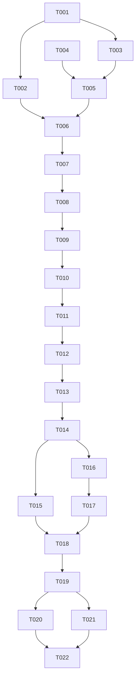

---
aliases:
  - Disk-Persistent Registry Cache Tasks
tags:
  - sdd
  - tasks
  - caching
created: 2026-11-24
status: draft
related:
  - "[[spec]]"
  - "[[plan]]"
---

# Implementation Tasks: Disk-Persistent Registry Cache

> [!info] References
> **Spec**: [[spec]]
> **Plan**: [[plan]]
> **Total tasks**: 22 (PR-A: 6, PR-B: 7, PR-C: 9)

> [!warning] Delivery rules
> Three stacked PRs, opened together, merged back to back. Each is green alone and targets `main` after its predecessor merges (`rebase --onto` after the squash). Each adds a one-line CHANGELOG entry ending with its PR link. Only PR-C carries `Closes #700`; PR-A and PR-B say "Part of #700". Edit only inside the worktree; never touch `crates/deps-zed` or `book/` (tech-writer only). Run the full check suite from `.claude/rules/branching.md` before each push.

## Progress

**PR-A (primitives, no behavior change)**
- [x] T001: Persist key types
- [x] T002: Freshness classification
- [x] T003: Entry format
- [x] T004: fs_probe additions
- [x] T005: Cache directory and ownership logic
- [x] T006: Config types and PR-A closeout

**PR-B (HttpCache wiring, production still memory)**
- [ ] T007: CachedResponse origin and PageRole threading
- [ ] T008: Disk tier state machine and read-through
- [ ] T009: Writer, queue and failure breaker
- [ ] T010: stale_on_disk and page-1 anchoring
- [ ] T011: Public API: set, flush, accessor
- [ ] T012: Integration, two-process and Windows tests
- [ ] T013: macOS durability measurement and PR-B closeout

**PR-C (default-on flip, `Closes #700`)**
- [ ] T014: Default flip and config field
- [ ] T015: deps-lsp wiring
- [ ] T016: deps-cli flag, config and flush
- [ ] T017: GitHub Action entrypoint
- [ ] T018: CI guard
- [ ] T019: Test-environment audit
- [ ] T020: README and book via tech-writer
- [ ] T021: Testing knowledge base
- [ ] T022: PR-C closeout

---

## Dependency Graph

---

# PR-A: Primitives (no behavior change)

### T001: Persist key types

**Context**: A typed, closed eligibility rule so no token-bearing URL can reach disk and `page` handling is explicit.
**Spec reference**: [[spec#FR-001]], [[spec#FR-008]], [[spec#FR-009]], [[spec#FR-013]]
**Acceptance criteria**:
- [x] `PersistableHost` (closed enum, `from_host`/`as_str`) lists exactly the 16 GET-only hosts in [[plan]] §3 (`ApiOsvDev` and `ApiDepsDev` removed, issue #2141); a deps-core unit test pins the literal list, and the pin against each ecosystem crate's default-base constants is delivered by the deps-engine `persist_hosts` test (issue #2140), because deps-core has no ecosystem dependencies
- [x] `PersistableQueryKey { Page, PerPage, OrderBy, Sort }`, `PageNumber(NonZeroU32)`, `PageRole::{ListingPage, Standalone}`
- [x] `PersistKey::new(url, tier, auth, accept, page_role) -> Option<PersistKey>` matches tier and auth exhaustively with no `_` arm; enforces https, no userinfo or fragment, default-port domain host, values `[A-Za-z0-9_.-]{1,32}`, no duplicate keys; `page` present with no declared role gives `None`
- [x] `PersistKey::sibling_page(n)` keeps query order and other pairs byte-identical; `None` when no `page` and `n > 1`
- [x] Table test: GitHub tags page, compare, releases and gitlab.com tags with `order_by`/`sort` admitted; `access_token=`, `private_token=`, unknown or duplicate keys, overlong value, userinfo, IP host, GHES host, `http`, non-default port, `Pinned`, `WorkspaceDeclared`, credentialed auth refused
- [x] proptest: `PersistKey::new` never panics on arbitrary strings
- [x] Every `pub` item documented with `///`; module docs describe responsibility (deviation: no `# Examples` on `pub(super)` items, doctests do not run there)
**Dependencies**: none
**Files**: `crates/deps-core/src/cache/persist/key.rs`, `crates/deps-core/src/cache/persist/mod.rs` (module declarations only)
**Complexity**: medium

---

### T002: Freshness classification

**Context**: Pure, total age logic implementing the R2 window and the page-1 rule.
**Spec reference**: [[spec#FR-003]], [[spec#FR-013]], [[spec#US-002: Bounded staleness *(restated, approved change)*|US-002]]
**Acceptance criteria**:
- [x] `ValidatedAt(SystemTime)`, `DiskFreshness { Fresh, Revalidate, Expired, FromFuture }`, constants `RESTORED_FRESHNESS_WINDOW` (10 min) and `MAX_PERSISTED_AGE` (7 days), private and not configurable
- [x] `classify(validated_at, now)` is total and pure; expected values: age 0 and W-1 s give `Fresh`; W gives `Revalidate`; 7 days minus 1 s gives `Revalidate`; 7 days gives `Expired`; mtime now+1 s and now+60 s (future skew) give `Revalidate`, never `Fresh`; mtime now+61 s gives `FromFuture`
- [x] `classify_restored(entry, page1, now)`: `ListingPage` page above 1 with no fresh page-1 anchor or `validated_at < t1` never returns `Fresh`; `Standalone` and page 1 use `classify` only
- [x] A backward clock jump never produces `Fresh` for an old entry (test)
- [ ] Docs with `# Examples` doctests (not met, deviation: the items are `pub(super)`, doctests do not run for them)
**Dependencies**: T001
**Files**: `crates/deps-core/src/cache/persist/freshness.rs`
**Complexity**: low

---

### T003: Entry format

**Context**: Self-describing, checksummed, bounded file format with a fingerprint for safe restamping.
**Spec reference**: [[spec#FR-004]], [[spec#FR-006]], [[spec#FR-012]], [[spec#NFR-003]]
**Acceptance criteria**:
- [x] Layout: magic `DEPSLSPC`, `u16` format version, `u32` header length (at most 64 KiB), `serde_json` header with `deny_unknown_fields` {url, accept, etag, last_modified, link, body_len, body_fnv1a64}, then body
- [x] `EntryFingerprint { etag, last_modified, accept, body_len, body_fnv1a64 }` with a header-only read helper capped at 64 KiB plus prefix
- [x] `PersistedEntry::decode(bytes, expected_url, expected_accept, now)` with `DecodeError` (thiserror: `BadMagic`, `ForeignVersion`, `HeaderTooLarge`, `Header`, `Truncated`, `Checksum`, `UrlMismatch`, `AcceptMismatch`, `Oversized`); `# Errors` documented
- [x] Round-trip test; a test per `DecodeError` variant; oversize body rejected, never truncated
- [x] proptest: `decode` never panics on arbitrary bytes
- [x] File name is `<fnv1a64(url) hex>.entry`; all `u64` length fields go through `usize::try_from` (i686-safe)
**Dependencies**: T001
**Files**: `crates/deps-core/src/cache/persist/format.rs`
**Complexity**: medium

---

### T004: fs_probe additions

**Context**: Safe primitives for no-follow reads with metadata, atomic writes with explicit mode and mtime, and a single-handle restamp. Legacy behavior must be unchanged.
**Spec reference**: [[spec#FR-007]], [[spec#FR-012]], [[spec#FR-014]], [[spec#NFR-004]]
**Acceptance criteria**:
- [x] `AtomicWrite { mode: FileMode, modified: Option<SystemTime> }`, `FileMode { PreserveTarget, OwnerOnly }`; `OwnerOnly` never copies the target's permissions (0600 on Unix); `write_atomic_bytes_with` refuses a symlinked final component and sets the mtime on the temp handle before rename
- [x] `read_capped_no_follow_with_metadata` returns bytes plus `Metadata` from the same handle, opened `O_NOFOLLOW` and `O_NONBLOCK` on Unix, regular files only (a FIFO test must not block)
- [x] `open_for_restamp`: write access, no truncate, `O_NOFOLLOW` on Unix; on Windows a symlink check immediately before the write-access open; `NotFound` propagated
- [x] Existing `write_atomic`/`write_atomic_bytes` behavior and callers unchanged (existing tests pass; deps-cli `update` keeps `PreserveTarget`)
- [x] Unix tests: 0600 mode, symlink refusal, FIFO, mtime set; Windows rename-over-open-handle test compiles under `cfg(windows)`
- [x] No `unsafe`; docs and doctests for new `pub` items
**Dependencies**: none
**Files**: `crates/deps-core/src/fs_probe.rs`
**Complexity**: medium

---

### T005: Cache directory and ownership logic

**Context**: Env-injected directory resolution and the creation order that never makes foreign-owned directories.
**Spec reference**: [[spec#FR-014]], [[spec#FR-015]], [[spec#FR-016]], [[spec#NFR-004]]
**Acceptance criteria**:
- [x] `CacheDirEnvVar { XdgCacheHome, Home, LocalAppData }` (private, closed; `OperatorEnvVar` untouched); `CacheDir::user_default(&impl EnvSource)` per platform rules, no filesystem access, absolute path only, `Err(NoCacheDir)` for missing `HOME` or relative `XDG_CACHE_HOME`
- [x] Unix open: probe uid from a `create_new` 0600 file in `temp_dir()` then deleted; existing root must be an owned directory (symlink followed, no mode check); missing root created by one non-recursive `create_dir` 0700 only when its parent is `$HOME` and `$HOME` is owned by the probe uid; macOS `Library/Caches` and Windows `%LOCALAPPDATA%` never created; components `deps-lsp/`, `http/`, `v1/` created 0700 ignoring `AlreadyExists` and verified by `symlink_metadata` (directory, owned, no group or other bits)
- [x] Per-file read check helper: regular file owned by the probe uid, no group or other write bit; otherwise a miss
- [x] `DiskTierError { NoCacheDir, CreateFailed, InsecureDirectory, ProbeFailed, Io }`
- [x] Prune: scan capped at 16384 entries; remove `*.tmp` older than 1 h, then expired files, then least recently validated until within 64 MiB and 2048 files; `NotFound` ignored
- [x] Unix tests with tempdir HOME via a fake env: missing root with owned HOME created 0700; root whose parent is not HOME gives memory and creates nothing; foreign-owned root (probe-uid test seam) gives memory and creates nothing; planted g+w file discarded; read-only root (chmod 0500) degrades; `user_default` table (XDG set, unset, relative; no HOME; macOS; Windows)
**Dependencies**: T003, T004
**Files**: `crates/deps-core/src/cache/persist/dir.rs`
**Complexity**: high

---

### T006: Config types and PR-A closeout

**Context**: Config enum without a default yet, target type, and the dead-code guard that PR-B removes.
**Spec reference**: [[spec#FR-010]], [[spec#FR-018]]
**Acceptance criteria**:
- [x] `CachePersistence { Memory, Disk }` (serde lowercase, unknown variants rejected, no `Default` impl yet); `PersistenceTarget { Memory, Disk(CacheDir) }` and `PersistenceTarget::from_config(CachePersistence, &impl EnvSource)` that returns `Memory` plus one warn when the directory cannot be resolved
- [x] `persist` module carries `#![cfg_attr(not(test), expect(dead_code, reason = "wired by PR-B, #700"))]` (met in spirit, deviation: an unconditional `#![expect(dead_code, reason = "wired by PR-B, #700")]` is used; the `cfg_attr` form fails under `-D warnings` in test builds)
- [x] No production behavior change: `HttpCache` untouched, workspace builds with `--all-features`
- [ ] CHANGELOG: `### Added` one line for the deps-core primitives; the PR link is added in a follow-up commit once the PR exists (PR numbers do not exist while the three PRs are being implemented); PR text says "Part of #700" (entry written; PR link pending until the PR exists)
- [ ] Full check suite passes: fmt, clippy `-D warnings`, nextest, doc gate (both `-D warnings` variants), `cargo tree -p deps-lsp -e features,no-dev` guard unchanged (pending until CI is green)
**Dependencies**: T002, T005
**Files**: `crates/deps-core/src/policy_config.rs`, `crates/deps-core/src/cache/persist/mod.rs`, `CHANGELOG.md`
**Complexity**: low

---

# PR-B: HttpCache wiring (production still memory)

### T007: CachedResponse origin and PageRole threading

**Context**: Mark restored entries and let callers declare page role.
**Spec reference**: [[spec#FR-003]], [[spec#FR-013]], [[spec#FR-018]]
**Acceptance criteria**:
- [ ] Private `origin: EntryOrigin` field on `#[non_exhaustive]` `CachedResponse`; every in-process construction is `Network`; no public API break
- [ ] Cache request carries `page_role: Option<PageRole>`; github.rs (the tags listing URL built at ~450 and used via `paginate_pages` gets `ListingPage`; `fetch_compare` `?per_page=1&page=2` at ~517 gets `Standalone`; the `/releases?per_page=100` URL at ~1064 has no `page` key and needs no role) and `deps-gitlab-ci` (tags and releases URLs in `client.rs` ~357, 364, 403, which carry `page=`) declare roles; grep confirms every `page=` URL builder in `crates/` declares one or is deliberately unpersisted
- [ ] Existing tests pass unchanged; `HttpCache::new()` and `with_policy()` remain `Memory`
**Dependencies**: T006
**Files**: `crates/deps-core/src/cache/response.rs`, `crates/deps-core/src/cache/mod.rs`, `crates/deps-core/src/github.rs`, `crates/deps-core/src/pagination.rs` (only if the role is threaded there), `crates/deps-gitlab-ci/src/client.rs`, `crates/deps-gitlab-ci/src/registry.rs`
**Complexity**: medium

---

### T008: Disk tier state machine and read-through

**Context**: The lazy, bounded, waiting read path that makes the first request wave hit disk.
**Spec reference**: [[spec#FR-002]], [[spec#FR-003]], [[spec#FR-004]], [[spec#FR-005]], [[spec#FR-015]], [[spec#FR-016]], [[spec#NFR-001]], [[spec#NFR-002]], [[spec|SC-002]]
**Acceptance criteria**:
- [ ] `DiskTierState { Unopened, Opening, Ready, Unavailable }`; the first eligible read or write triggers one `spawn_blocking` open per target; `Unavailable` is terminal and a late-completing open never flips it back
- [ ] Read-through on an in-memory miss for an eligible key inside `get_cached_via` before the network fetch: an 8-permit `tokio::sync::Semaphore`; the 250 ms timer covers the blocking read only; a permit-wait or `Opening`-wait timeout is a miss and never degrades the tier; the first read timeout degrades the tier with one warn
- [ ] Reads while `Opening` await the transition (`watch` or `Notify`) bounded by 250 ms; writes while `Opening` are dropped
- [ ] Decode, owner-check, classify; `Fresh` is promoted and served with no request (span fields `cache="hit"`, `disk="fresh"`); `Revalidate` joins the existing cached branch; `Expired` and `FromFuture` delete the file and miss; promoted entries count against the in-memory budget via a non-persisting insert; `EntryOrigin::Restored` recorded
- [ ] The window applies only to `Restored` entries; a later 304 does not reset the in-memory stamp
- [ ] Offline serves `Fresh` and `Revalidate`; `CacheMode::Disabled` bypasses the disk; `peek_cached` stays memory-only
- [ ] On the first successful use of a target (tier `Ready` and first entry read or written) one `tracing::info!` names the directory, exactly once per process and target
- [ ] A `#[cfg(test)]` disk-access counter exists in the store for the NFR tests below
- [x] Windows `CacheDir::open` (`cfg(windows)`, std only per [[spec#NFR-004]] and [[spec#NFR-005]]; delivered by the #2141/#2145 PR): creates `deps-lsp/http/v1` under `%LOCALAPPDATA%`, never creates the `%LOCALAPPDATA%` root itself, and verifies each component is a directory and not a reparse point; trust is the per-user `%LOCALAPPDATA%` ACL, with no owner check; owner/DACL verification is tracked in follow-up issue #2146, and the Windows `open_no_follow_with` reparse race in #2147
- [ ] Decode errors are logged by `DecodeError` variant, never with `%error` (`DecodeError::Header` quotes file content); follow-up #2142
- [ ] The open-failure degrade warning names the cache path and the reason ([[spec#FR-015]]); follow-up #2142
- [ ] The read path's file name lookup and the `decode` `expected_url` use `PersistKey::url()` (the normalized URL), see Implementation notes (PR-A); follow-up #2142
- [ ] Tests (#2142): a corrupt header with a secret-shaped marker in its content fails decode and the captured tracing output names the `DecodeError` variant without the marker; the degrade warning (open failure and first-read timeout) contains the cache path and the reason; a mixed-case host or `:443` URL written earlier is found on disk through `PersistKey::url()` with `decode` accepting it as `expected_url`
- [ ] Entry trust checks use the metadata of the same handle that read the bytes (owner, mode, mtime), never a separate `stat`
- [ ] Tests: open in progress then the read waits and hits (does not miss), including N concurrent first-wave reads that all hit disk (SC-002); open slower than 250 ms yields a miss without degrading; semaphore-wait timeout does not degrade; a blocking read slower than 250 ms (test seam delay) degrades the tier with exactly one warn and later reads are misses ([[spec#FR-015]]); the `info!` appears exactly once across several successful uses (captured tracing subscriber); NFR-001: `set_persistence(Disk(tmp))` leaves the directory absent until the first eligible op; NFR-002: the disk-access counter stays 0 across repeated in-memory hits even after the directory is made unreadable
**Dependencies**: T007
**Files**: `crates/deps-core/src/cache/persist/mod.rs`, `crates/deps-core/src/cache/fetch.rs`, `crates/deps-core/src/cache/store.rs`, `crates/deps-core/src/cache/tests/`
**Complexity**: high

---

### T009: Writer, queue and failure breaker

**Context**: Write-behind with newest-validation-wins and safe restamping.
**Spec reference**: [[spec#FR-006]], [[spec#FR-007]], [[spec#FR-012]], [[spec#FR-015]], [[spec#FR-016]]
**Acceptance criteria**:
- [ ] Bounded mpsc queue (256 ops, 16 MiB queued body bytes, atomic counter), `try_send` drops when full, never blocks; one writer spawned lazily on the first enqueue; ops applied via `spawn_blocking`
- [ ] `DiskOp::{Put, Validated, Remove}` carry `validated_at`; writer per key: stat the existing file and drop the op if its mtime is later than `validated_at`; `Validated` reads only the header through one `open_for_restamp` handle and restamps only if the fingerprint matches, otherwise writes the full entry; a full write sets mtime to `validated_at` (never the write time)
- [ ] An oversize 200 enqueues `Remove` (and marks `stale_on_disk`, T010); 304 on an eligible key enqueues `Validated`
- [ ] `WriteFailure::{Persistent, Transient}`: `StorageFull`, `QuotaExceeded`, `ReadOnlyFilesystem` count toward the 8-failure breaker (then `Unavailable`, one warn); `PermissionDenied` and Windows raw 32 or 5 never count; a single failure logs at `debug`
- [ ] Prune runs when the writer starts and every 64 puts
- [ ] `open_for_restamp` handle is `fstat`ed (PR-A discards its metadata); the restamp decision and trust checks use that same-handle metadata; follow-up #2142
- [ ] The writer's file name and header `url` come from `PersistKey::url()` (the normalized URL); follow-up #2142
- [ ] Tests (#2142): a mixed-case host or `:443` URL is written and read under the file name and header `url` of `PersistKey::url()` and hits on a fresh store; with a `Validated` op, a file whose same-handle metadata shows a foreign owner, non-regular type or later mtime is neither restamped nor overwritten
- [ ] mtime on NFS/SMB: `write_atomic_content` calls `set_modified` before `sync_all`, and restamp-as-freshness may break on SMB and some NFS; verify that the mtime survives, or document the limit and reword [[plan]] "NFS-safe" (§ concurrency row); follow-up #2142
- [x] POST hosts are removed from `PersistableHost` (`api.osv.dev` and `api.deps.dev`, issue #2141)
- [ ] Keys are built only on the GET path; test: a POST to a still-persistable host (e.g. `registry.npmjs.org`) never enqueues a `DiskOp`
- [ ] Before each prune pass and each write batch the writer re-verifies the store path component chain (`symlink_metadata`: directory, owned, no group or other bits) and degrades on mismatch; closes the symlink swap window after `open` when the cache root is group or other writable (security finding L1/F1, see the `[NEEDS CLARIFICATION]` on [[spec#NFR-004]])
- [ ] Tests: dropped-Put scenario (v2 in memory, v1 on disk, 304 for v2 gives a full write of v2, never a restamp of v1); a file with a later mtime is not overwritten; queue overflow drops without blocking; a transient rename error does not trip the breaker; 8 persistent errors via a store write-failure seam give `Unavailable` with exactly one warn
**Dependencies**: T008
**Files**: `crates/deps-core/src/cache/persist/mod.rs`, `crates/deps-core/src/cache/store.rs`, `crates/deps-core/src/cache/fetch.rs`, `crates/deps-core/src/cache/tests/`
**Complexity**: high

---

### T010: stale_on_disk and page-1 anchoring

**Context**: Never serve a known-older disk copy, and never mix a fresh page 1 with an old later page.
**Spec reference**: [[spec#FR-012]], [[spec#FR-013]]
**Acceptance criteria**:
- [ ] `stale_on_disk` session set (cap 4096; overflow suspends read-through for the session); read-through skips keys in it; the writer clears a key once its `Put` is applied; keys in it always enqueue `Put`, never `Validated`
- [ ] Page-1 rule in the read path: for `ListingPage` with `PersistKey::page() > 1`, `Fresh` only when the `sibling_page(1)` entry is in memory as `Restored` and `Fresh` and own `validated_at >= t1`; page 1 absent or `Network` gives `Revalidate`; `Standalone` classified by own age
- [ ] Tests: new page 1 at T1 with old page 2 at T0, restart revalidates page 2 and the merged list contains the old tag; page 1 `Network` makes page 2 revalidate; `Standalone` compare probe is served `Fresh`; oversize 200 then memory eviction does not serve the old copy within the window
**Dependencies**: T009
**Files**: `crates/deps-core/src/cache/persist/mod.rs`, `crates/deps-core/src/cache/fetch.rs`, `crates/deps-core/src/cache/tests/`
**Complexity**: medium

---

### T011: Public API: set, flush, accessor

**Context**: The adapter-facing surface; production still calls nothing.
**Spec reference**: [[spec#FR-010]], [[spec#FR-017]], [[spec#FR-018]], [[spec#NFR-009]]
**Acceptance criteria**:
- [ ] `HttpCache::set_persistence(&self, PersistenceTarget)`: no I/O on the caller, live toggle like `set_offline`; `Memory` guarantees no directory is created; `HttpCache::new()`/`with_policy()` stay `Memory` (test: tempdir HOME stays empty after fetches; NFR-001: with `Disk(tmp)` set, `tmp` stays absent or empty until the first eligible operation)
- [ ] `HttpCache::flush_persistence(&self, Duration) -> FlushOutcome { Drained, TimedOut, Inactive }`, async, never errors
- [ ] `persistence_target()` is `#[cfg(feature = "test-util")] #[doc(hidden)] pub`; `cargo tree -p deps-lsp -e features,no-dev` unchanged
- [ ] `#![expect(dead_code)]` from T006 removed; no production adapter calls `set_persistence` (grep)
- [ ] Docs with `# Examples` and `# Errors` where applicable
**Dependencies**: T010
**Files**: `crates/deps-core/src/cache/mod.rs`, `crates/deps-core/src/cache/persist/mod.rs`
**Complexity**: low

---

### T012: Integration, two-process and Windows tests

**Context**: Prove the system end to end under `#[cfg(test)]` loopback admission.
**Spec reference**: [[spec#US-001: Warm restart sends no registry requests|US-001]], [[spec#US-002: Bounded staleness *(restated, approved change)*|US-002]], [[spec#US-003: Safe with concurrent processes|US-003]], [[spec#FR-001]], [[spec#FR-005]], [[spec#FR-007]], [[spec#FR-008]], [[spec#FR-009]], [[spec|SC-001]], [[spec|SC-003]], [[spec|SC-004]]
**Acceptance criteria**:
- [ ] `#[cfg(test)] fn loopback_admitted` in `PersistKey::new` admits `http`/`https` loopback hosts (`127.0.0.1`, `::1`, `localhost`) on any port; no enum variant and no `feature = "test-util"` path
- [ ] mockito + tempdir tests: restart inside the window sends 0 hits; after the window one conditional request returns 304 and restamps the mtime; offline restart serves with no request; `Accept` mismatch is a miss; credentialed, `Pinned` and `WorkspaceDeclared` entries never appear on disk; `CacheMode::Disabled` neither reads nor writes
- [ ] Two-process test in `crates/deps-core/src/cache/tests/`: re-spawn `current_exe()` with `--exact <test>` and a role env var (so `cfg(test)` holds in children); two children do N reads and writes on the same keys; zero decode failures (also with torn-read assertions)
- [ ] Windows test: rename over a file another handle holds open succeeds (runs in the Windows nextest shards)
- [ ] FIFO planted at an entry name does not block and is discarded
- [ ] First-wave test (SC-002): after a restart on a populated fresh directory, N concurrent first requests all resolve from disk with 0 mock hits
**Dependencies**: T011
**Files**: `crates/deps-core/src/cache/tests/` (new files), `crates/deps-core/src/cache/persist/key.rs`
**Complexity**: high

---

### T013: macOS durability measurement and PR-B closeout

**Context**: Decide with data whether a durability knob is needed.
**Spec reference**: [[spec#FR-016]], [[spec#NFR-005]]
**Acceptance criteria**:
- [ ] On macOS, a 1000-entry first session is run (`sync_all` maps to `F_FULLFSYNC`); the number of dropped puts and wall time are recorded in the PR description
- [ ] Only if more than 10% of puts are dropped, add `Durability::{Synced, Unsynced}` to `AtomicWrite` citing the numbers (otherwise no change, and say so in the PR text)
- [ ] CHANGELOG: `### Added` one line "disk tier in deps-core (disabled unless set)"; the PR link is added in a follow-up commit once the PR exists; PR text says "Part of #700"
- [ ] Full check suite passes (same gates as T006), CI green
**Dependencies**: T012
**Files**: `crates/deps-core/src/fs_probe.rs` (only if the threshold is exceeded), `CHANGELOG.md`
**Complexity**: low

---

# PR-C: Default-on flip (`Closes #700`)

### T014: Default flip and config field

**Context**: The single behavior-changing switch, revertable on its own.
**Spec reference**: [[spec#FR-010]], [[spec#US-004: Safe default for every user|US-004]]
**Acceptance criteria**:
- [ ] `#[default] Disk` on `CachePersistence`; `CacheConfig.persistence` field (`#[non_exhaustive]` struct, additive)
- [ ] Tests: `CachePersistence::default() == Disk`; `HttpCache::new()` is still `Memory`; unknown variant rejected by `parse_config`
**Dependencies**: T013
**Files**: `crates/deps-core/src/policy_config.rs`
**Complexity**: low

---

### T015: deps-lsp wiring

**Context**: Default-on without `initializationOptions`, env seam intact.
**Spec reference**: [[spec#FR-011]], [[spec#FR-017]], [[spec#US-004: Safe default for every user|US-004]]
**Acceptance criteria**:
- [ ] `ServerState::from_env_source(source)` resolves `PersistenceTarget::from_config(CachePersistence::default(), source)` once, stores `persistence_dir: Option<CacheDir>`, and calls `cache.set_persistence(target)` before returning; `with_registry_environment` becomes private and takes the resolved target (it has one caller, `document/state.rs`)
- [ ] `ConfigSideEffects` gains `persistence: CachePersistence`; `apply_resolved_config` only toggles (`Memory` sets `Memory`; `Disk` sets `Disk(state.persistence_dir)` or `Memory` when `None`) and never reads the environment; `did_change_configuration` without the key deserializes to the default
- [ ] LSP `shutdown` calls `flush_persistence(2 s)`
- [ ] Test (fake env with `HOME` = tempdir, no options): the cache target equals `Disk(<tmp>/.cache/deps-lsp/http/v1)` (macOS `Library/Caches` variant) via `persistence_target()`; a follow-up `didChangeConfiguration` with `"memory"` flips it to `Memory`; assertion is on the resolved target, not a fetch
- [ ] A test `ServerState` built from a fake env without `HOME` resolves to `Memory`
- [ ] NFR-001: constructing a `ServerState` from a fake env with a tempdir `HOME` creates no directory before the first eligible operation
**Dependencies**: T014
**Files**: `crates/deps-lsp/src/document/state.rs`, `crates/deps-lsp/src/server.rs`
**Complexity**: medium

---

### T016: deps-cli flag, config and flush

**Context**: CLI parity, including config-less CI runs.
**Spec reference**: [[spec#FR-010]], [[spec#FR-017]], [[spec#FR-015]]
**Acceptance criteria**:
- [ ] `--cache-persistence <memory|disk>` on `check` and `update`, a CLI-local `clap::ValueEnum` mapped to `CachePersistence` by an exhaustive `From`; the flag overrides the config key; no env vars; deps-core stays clap-free
- [ ] `build_runtime_handles(source)` applies the resolved target; `flush_persistence(2 s)` runs before exit; exit codes and output unchanged when the directory is unusable
- [ ] deps-cli keeps using `deps-engine` re-exports only (no direct ecosystem crate deps)
- [ ] Tests: flag parsing; flag overrides config; `--offline` with disk serves restored entries; `memory` creates no directory even after eligible fetches
**Dependencies**: T014
**Files**: `crates/deps-cli/src/cli.rs`, `crates/deps-cli/src/main.rs`, `crates/deps-engine/` (only if the handle helper lives there)
**Complexity**: medium

---

### T017: GitHub Action entrypoint

**Context**: Ephemeral container; avoid root-owned files in the mounted `/github/home`.
**Spec reference**: [[spec#FR-010]]
**Acceptance criteria**:
- [ ] `entrypoint.sh` passes `--cache-persistence memory`
- [ ] `crates/github-action/tests/entrypoint_test.sh` asserts the flag is passed
- [ ] README note that this takes effect with the next image release (`action.yml` pins a digest); the pin is not edited here
**Dependencies**: T016
**Files**: `crates/github-action/entrypoint.sh`, `crates/github-action/tests/entrypoint_test.sh`
**Complexity**: low

---

### T018: CI guard

**Context**: The suite must never write to a runner's real cache directory.
**Spec reference**: [[spec#NFR-007]], [[spec|SC-005]]
**Acceptance criteria**:
- [ ] In the `test` job, steps gated by `if: matrix.os == 'ubuntu-latest'` (the matrix also holds macOS, Windows and the beta leg): a step runs `mkdir -m 700 -p "$XDG_CACHE_HOME"` before any cargo step (otherwise the guard is vacuous), `XDG_CACHE_HOME: ${{ runner.temp }}/xdg-cache` is set for **every** cargo step of that leg (nextest, the explicit trybuild steps and `cargo test --doc`, `.github/workflows/ci.yml` ~1027-1090), for example through a matrix-conditional env, and a final step runs `test ! -e "$XDG_CACHE_HOME/deps-lsp"`
- [ ] Verified that the guard can fail: a throwaway run (locally or in the PR) that writes under the directory makes the step fail
- [ ] macOS and Windows have no guard; documented in a workflow comment
- [ ] Workflow validated with `fy validate`; any action reference stays SHA-pinned
**Dependencies**: T015, T017
**Files**: `.github/workflows/ci.yml`
**Complexity**: low

---

### T019: Test-environment audit

**Context**: Default-on must not make the existing suites touch a real home.
**Spec reference**: [[spec#FR-018]], [[spec|SC-005]]
**Acceptance criteria**:
- [ ] deps-lsp and deps-cli test constructors and the deps-cli binary integration tests either use `--cache-persistence memory`, a fake env, or a tempdir `HOME`; a post-run check shows nothing under `$XDG_CACHE_HOME/deps-lsp` when nextest runs with the T018 environment locally
- [ ] Note in the PR text that 356 `ServerState::new()` sites read the real `HOME`: protection is the host list, lazy open and the CI guard
**Dependencies**: T018
**Files**: `crates/deps-lsp/src/` and `crates/deps-lsp/tests/` (constructors), `crates/deps-cli/tests/`
**Complexity**: medium

---

### T020: README and book via tech-writer

**Context**: Users must learn what is stored, how to disable it and what staleness to expect. `book/` is editable only by `tech-writer`.
**Spec reference**: [[spec#NFR-008]], [[spec#US-004: Safe default for every user|US-004]]
**Acceptance criteria**:
- [ ] Delegate to the `tech-writer` agent: first run, disable (`"cache": {"persistence": "memory"}`, `cache.persistence = "memory"`, `--cache-persistence memory`), rollback (delete `<cache>/deps-lsp/`; stale `vN` directories are safe to delete), the 10-minute staleness note, and one line that public package names stay in the OS cache directory for up to 7 days
- [ ] Root `README.md` and affected crate READMEs (`deps-core`, `deps-cli`, `deps-lsp`, `github-action`) updated via `/readme-generator`; crate README dependency snippets use major.minor only
- [ ] Nobody but `tech-writer` edits `book/`
**Dependencies**: T019
**Files**: `README.md`, `crates/deps-core/README.md`, `crates/deps-cli/README.md`, `crates/deps-lsp/README.md`, `crates/github-action/README.md`, `book/src/` (tech-writer only)
**Complexity**: medium

---

### T021: Testing knowledge base

**Context**: The Registry Integration Gate and continuous-improvement cycles must account for default-on. `.local/` is gitignored and not carried across worktrees, so author these in the main checkout.
**Spec reference**: [[spec|SC-001]], [[spec|SC-002]], [[spec|SC-003]]
**Acceptance criteria**:
- [ ] Playbooks in `.local/testing/playbooks/` run live registry checks with `cache.persistence = "memory"` (or after deleting `<cache>/deps-lsp`); `lsp-harness.md` states this
- [ ] SC-001 procedure added: `/rate_limit` `core.used` before and after a restart within the window, persistence enabled
- [ ] `coverage.md` row for the disk tier; `regressions.md` entries for mixed-age listing pages, dropped Put then 304, and standalone compare probe
- [ ] A live run recorded: restart within the window sends 0 GitHub requests for at least 10 pins
- [ ] SC-002 recorded: median of 5 warm vs 5 cold (`memory`) first-hover times on the same workspace, warm at most cold + 50 ms
**Dependencies**: T019
**Files**: `.local/testing/coverage.md`, `.local/testing/playbooks/*.md`, `.local/testing/regressions.md` (main checkout, not committed)
**Complexity**: low

---

### T022: PR-C closeout

**Context**: The only PR that closes #700 and ships the behavior change.
**Spec reference**: [[spec#FR-010]], [[spec#US-004: Safe default for every user|US-004]]
**Acceptance criteria**:
- [ ] CHANGELOG `[Unreleased]`: `### Breaking` one `**behavior**:` line (deps-lsp and deps-cli persist public registry responses under the OS cache directory by default and reuse them for up to 10 minutes after a restart; `cache.persistence = "memory"` or `--cache-persistence memory` disables it) plus `### Added` for the CLI flag, each ending with the PR link, added in a follow-up commit once the PR exists; no version bump
- [ ] PR body has `Closes #700` on its own line; PR-A and PR-B bodies do not
- [ ] All three PRs opened together and merged back to back
- [ ] `specs/MOC-specs.md` row 051 updated to `shipped` with the PR and issue reference after merge
- [ ] Full check suite passes: fmt, clippy `-D warnings`, nextest, both rustdoc gates, doctests, `cargo deny`, no-dev tree guard; CI green
- [ ] Local build artifacts cleaned (`cargo clean`) after the PRs are created
**Dependencies**: T020, T021
**Files**: `CHANGELOG.md`, `specs/MOC-specs.md`
**Complexity**: low

---

## Implementation Notes

### Implementation notes (PR-A)

Deviations and additions approved during PR-A (T001-T006); PR-B builds on them.

- `StoreDir::prune` is a forwarder to the prune logic in `dir.rs`.
- `DecodeError::Io` added for read failures during decode.
- `PersistKey::page_role()` accessor added.
- `CachePlatform` test seam added so per-platform path rules are testable on any OS.
- `PruneReport` returned by prune, including a `failed` count.
- `EntryFingerprint` covers the full header, not only the five fields listed in T003.
- `PersistedEntry::new` returns `EncodeError { HeaderTooLarge, Oversized }`, so oversized headers and bodies are rejected at construction.
- An empty `XDG_CACHE_HOME` is treated as unset.
- `PageNumber` rejects leading zeros (canonical decimal only).
- `PersistKey::url()` returns the normalized URL; PR-B must use it for the file name, the header `url` and the `decode` expectation.
- Trailing bytes after the body are ignored by `decode`; body integrity is covered by `body_len` and the checksum ([[plan]] §12 reworded to match).
- Tracked in issues: #2140 (`PersistableHost` constant pin), #2141 (POST must never be persisted), #2142 (PR-B carry-overs: decode logging, path in degrade warning, restamp handle checks, `key.url()` everywhere, mtime on NFS/SMB).

### Implementation notes (PR-A follow-ups)

- #2141: `ApiOsvDev` and `ApiDepsDev` are removed from `PersistableHost` (18 to 16 hosts): every POST in the workspace targets them and their responses depend on the body; their GET responses never reach `HttpCache`.
- #2145: the Windows `CacheDir::open` is std-only per [[spec#NFR-004]] (per-user ACL, directory and non-reparse-point component checks, no owner check); owner/DACL verification is follow-up #2146 and the `fs_probe` Windows reparse race is follow-up #2147.

### Order of execution
PR-A tasks T001 and T004 can run in parallel; T002 and T003 follow T001; T005 needs T003 and T004. PR-B is strictly sequential through T012. In PR-C, T015 and T016 can run in parallel after T014.

### Common patterns
Use `deps-core::fs_probe` for all file access, `deps-core::pagination` for page handling, and `redact::` for any logged URL. Follow the typed-enum style of `EcosystemId`; no catch-all arms on new exhaustive enums.

### Gotchas
- Shared worktree: other agents may be editing the same checkout; never run `cargo fmt --all` or broad `git checkout --`.
- Disk: use `-p` builds and `CARGO_INCREMENTAL=0`; check `df` first.
- The loopback test admission is `#[cfg(test)]` only; deps-lsp tests cannot fetch through it and assert on the resolved target instead.
- `HttpCache::new()` must stay `Memory`; any test that needs disk calls `set_persistence` with a tempdir `CacheDir`.
- Anonymous GitHub 304s spend quota; do not "optimize" by always revalidating restored entries inside the window.

## See Also

- [[spec]] — feature specification
- [[plan]] — technical plan
- [[MOC-specs]] — all specifications
