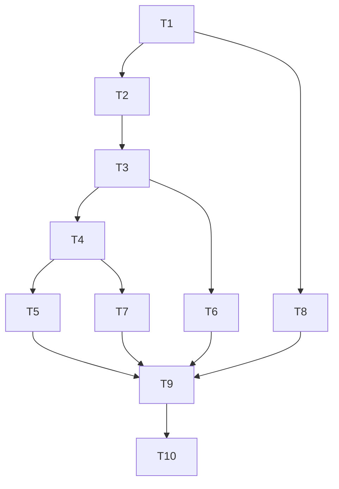

---
tags:
  - sdd
  - tasks
  - ecosystem/npm
created: 2026-10-21
status: tasks
related:
  - "[[spec]]"
  - "[[plan]]"
  - "[[MOC-specs]]"
---

# Tasks: pnpm-workspace.yaml catalog entries (issue #1788)

| ID | Task | Spec refs | Files | Depends | Complexity |
|----|------|-----------|-------|---------|------------|
| T1 | deps-core: add `DiagnosticKind::DuplicateDefaultCatalog` (code `pnpm-duplicate-default-catalog`, Error). deps-cli: `classify` arm mapping it to `Category::Other` (default fail set unchanged) | FR-030, FR-035 | `deps-core/src/lsp_helpers/*diagnostic*`, `deps-cli/src/{cli,report}.rs` | none | S |
| T2 | deps-npm types: `CatalogId`, `CatalogSite`, `CatalogName`, `NpmManifestKind`, `NpmDependencyOrigin`; replace `section`/`catalog`; convert the 19 `.section` reads to exhaustive matches; drop `DEFAULT_CATALOG_KEY` | NFR-005, NFR-010 | `deps-npm/src/{types,catalog,parser,formatter,ecosystem}.rs` | T1 | L |
| T3 | `parse_workspace_document` positioned parser (block-scalar findings anchored on the header indicator, never the content range); derive `PnpmWorkspaceConfig` from it; retarget fuzz target | FR-005..012, FR-024..029, FR-032, NFR-001, NFR-002, NFR-004 | `deps-npm/src/catalog.rs`, fuzz target | T2 | L |
| T4 | Routing: `manifest_filenames`, `parse_manifest` dispatch on `NpmManifestKind`, FR-004 non-file URIs, conformance pin | FR-001..004 | `deps-npm/src/ecosystem.rs`, `deps-lsp` conformance test | T3 | M |
| T5 | Catalog-entry pipeline: formatter/code actions/update-all/completion/links with `CatalogEntry` origin; in-use version via pnpm-lock provider | FR-008..009, FR-013..020, FR-033 | `deps-npm/src/{formatter,ecosystem,lockfile}.rs` | T4 | M |
| T6 | `CatalogEntryLocation` plus `package.json` suffix and `related_information` (canonical URI via spec 066 mapping) | FR-031, NFR-006 | `deps-npm`, `deps-lsp` interop mapping | T3 | M |
| T7 | Duplicate-default diagnostic emission; save-triggered refresh of referencing `package.json` | FR-012, FR-023, FR-030 | `deps-npm`, `deps-lsp` watched-config path | T4 | S |
| T8 | Docs: book `npm.md` (editor association, CLI duplicates, stale range limitation), CLI chapter, CHANGELOG (`### Added`), `coverage.md`, npm playbook, `regressions.md` | NFR-011, D-8 | `book/src`, `CHANGELOG.md`, `.local/testing` (main repo) | T1 | S |
| T9 | Tests: position matrix incl. block scalars (`>-`, `|`) with no edit, CLI `update` empty `current` without lock file, bounds, edits, protocol, CLI (SC-008), snapshots, `CatalogId` collision | SC-002..008 | crate tests | T5, T6, T7, T8 | L |
| T10 | Live gate: SC-001, SC-005 fixtures against npm; full CI check suite | SC-001, SC-005 | n/a | T9 | S |

Each task is complete only when per-crate fmt, clippy and tests pass; the lead runs the full workspace suite once.
