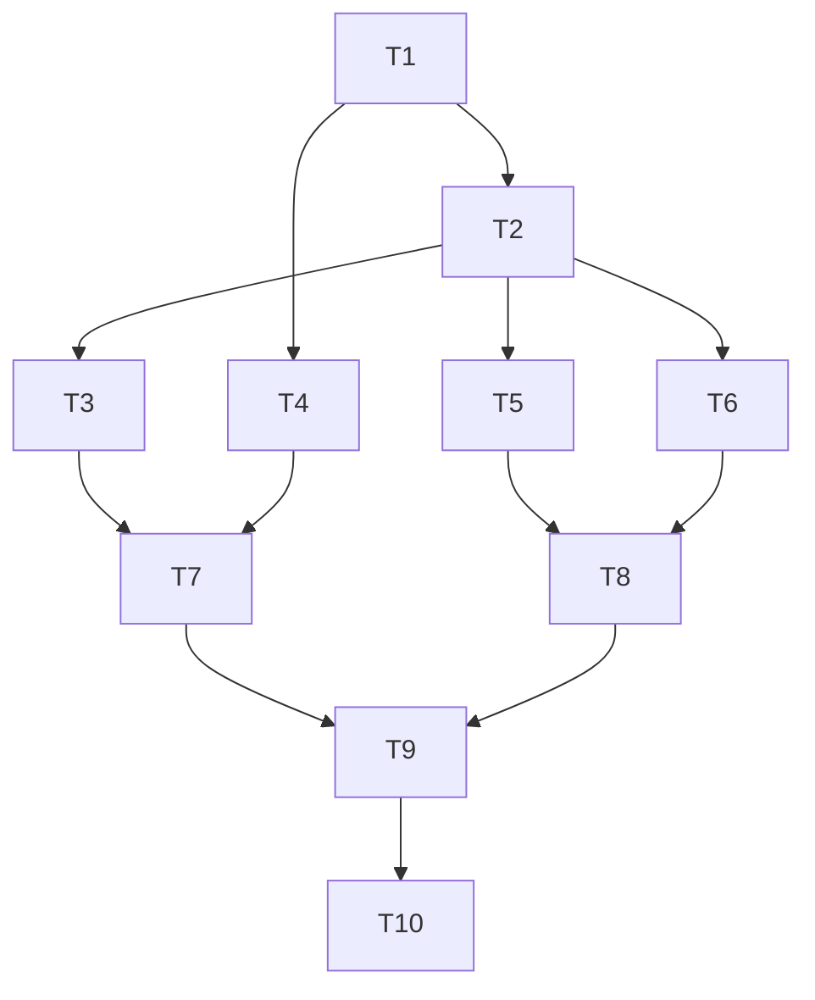

---
tags:
  - sdd
  - tasks
created: 2026-10-21
status: tasks
related:
  - "[[spec]]"
  - "[[plan]]"
  - "[[MOC-specs]]"
  - "[[087-commit-lineage-membership-probe/tasks|087 tasks]]"
---

# Tasks: git-ref probe infrastructure (#1778)

Deps-core tasks (T1-T4) land together with the 087 and 088 deps-core items, then the lead runs the full suite; T5 onward are per-crate.

| ID | Task | Spec refs | Files | Depends | Size |
|----|------|-----------|-------|---------|------|
| T1 | `TokenBucket`, `QuotaMeter` (newest-wins, min-in-window), `ProbeAllowance`/`ProbePermit`; unit tests incl. stale-replay | FR-021..025 | `deps-core/src/rate_limit.rs` | #1873 | M |
| T2 | Fetch-layer live quota feed (network responses only), `GithubTagsClient` to trusted-origin path | FR-Q1..Q4, FR-026 | `deps-core/src/cache/fetch.rs`, `deps-github-actions/src/registry.rs` | T1 | M |
| T3 | `ProbeRef`, `BranchEvidence`, evidence store, `ProbeReport`/`ProbeEffect`, `background_probes` default, event kinds | FR-001, 002, 007, 017..019, 028 | `deps-core/src/lsp_helpers/git_probe.rs`, `ecosystem.rs`, `tag_index_refresh.rs` | T1 | M |
| T4 | `UnpublishedRef::NotABranch`, `refine`, `with_branch_evidence`, message, arms | FR-013..016 | `deps-core/src/lsp_helpers/git_ref.rs` | T1 | M |
| T5 | GitHub Actions branch probe and `background_probes` impl | FR-009, 010, 012, 020, 027 | `deps-github-actions` | T2, T3, T4 | M |
| T6 | GitLab CI branch probe (Tags index only), per-host allowance | FR-011, 021, 023 | `deps-gitlab-ci` | T2, T3, T4 | M |
| T7 | deps-engine `probe` module and CLI wiring: await, `Reparse`, stderr note, offline skip, help text | FR-008, 029, 030, 031 | `deps-engine`, `deps-cli/src/cli.rs` | T3, T4 | M |
| T8 | deps-lsp `spawn_background_probes`: open, change, `TagIndexRefreshes` triggers; single-flight; `RefreshEvent` listener (`ProbeEvidence` republish-only), `ProbePhase` | FR-003..007 | `deps-lsp/src/document/lifecycle.rs`, `tag_refresh.rs` | T5, T6 | L |
| T9 | Tests: mockito matrix, traversal zero-hit, budget exhaustion silence, trigger and single-flight tests, CLI `@v40`; docs (book, CHANGELOG, testing KB) | section 9 | crates, `book/src` | T7, T8 | L |
| T10 | Live gate SC-001 (`ruby/setup-ruby@v1` vs `@v40`); full CI suite | SC-001 | n/a | T9 | S |
