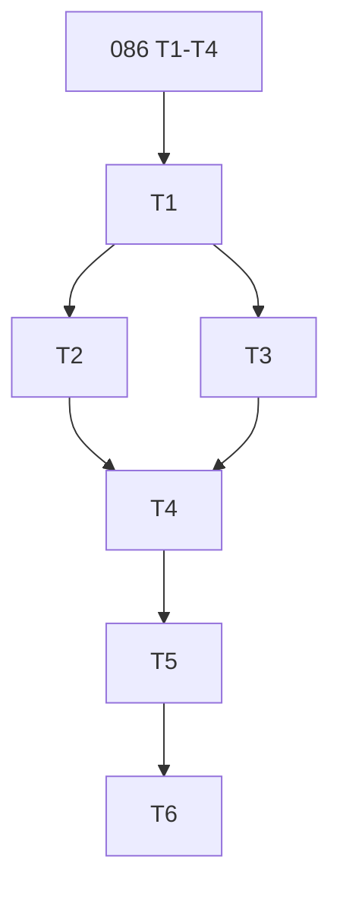

---
tags:
  - sdd
  - tasks
created: 2026-10-21
status: tasks
related:
  - "[[spec]]"
  - "[[plan]]"
  - "[[MOC-specs]]"
  - "[[086-git-ref-probe-branch-evidence/tasks|086 tasks]]"
---

# Tasks: commit lineage and membership (#1725)

Depends on spec 086 tasks T1-T4 (deps-core infrastructure). deps-core items below land in the same Phase 0 as 086.

| ID | Task | Spec refs | Files | Depends | Size |
|----|------|-----------|-------|---------|------|
| T1 | deps-core: `CommitLineage`, `DefaultBranchMembership`, `CommitEvidence`/`AheadProof`, two LRUs, status override + update-all exclusion + hover line | FR-004..007, NFR-004 | `deps-core/src/lsp_helpers/{git_probe,git_ref}.rs` | 086 T3, T4 | M |
| T2 | GitHub Actions compare client, `CompareStatus`, 256 KiB limit, lineage then membership | FR-001..003, 008..011 | `deps-github-actions` | T1 | M |
| T3 | GitLab CI merge-base client and mapping | FR-002, 003 | `deps-gitlab-ci` | T1 | M |
| T4 | Engine ordering (lineage, membership, branch), CLI parity, offline skip | FR-011..013 | `deps-engine` | T2, T3 | S |
| T5 | Tests: mockito matrix, LRU hit zero-request, key change on new release, TTL vs no-TTL, update-all exclusion; docs (book, CHANGELOG, testing KB) | section 8, FR-014 | crates, `book/src` | T4 | M |
| T6 | Live gate SC-001, SC-002; full CI suite | SC-001..004 | n/a | T5 | S |
