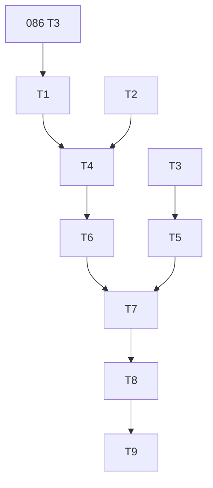

---
tags:
  - sdd
  - tasks
  - ecosystem/swift
created: 2026-10-21
status: tasks
related:
  - "[[spec]]"
  - "[[plan]]"
  - "[[MOC-specs]]"
  - "[[086-git-ref-probe-branch-evidence/tasks|086 tasks]]"
---

# Tasks: Swift SCM-to-registry swizzling (#1757)

Depends on spec 086 tasks T1-T3 (`ProbePhase`, `ProbeReport`, `RefreshEvent`). deps-core tasks T1-T3 land in the shared Phase 0.

| ID | Task | Spec refs | Files | Depends | Size |
|----|------|-----------|-------|---------|------|
| T1 | deps-core: `ScmToRegistry` setting, `PolicyConfigDiff` entry, `redact::strip_url_credentials` | FR-001, 002, 007 | `deps-core/src/{policy_config,redact}.rs` | 086 T3 | M |
| T2 | deps-core: `OsvNaming::public_content` + `PublicContent<'d>`, switch the 5 sites, conformance fixture | FR-020, 022..024 | `deps-core/src/{osv/types,lsp_helpers/mod,conformance}.rs`, `deps-engine/src/classify/{osv,license}.rs` | none | L |
| T3 | deps-core: `RefreshEvent::ReparseOpenDocuments { generation }` | FR-018 | `deps-core/src/tag_index_refresh.rs` | 086 T3 | S |
| T4 | deps-swift: `ScmLookupUrl`, `IdentityLookup`, identifiers endpoint (retry, `RegistryIdentity::parse` gate), `SwiftRequirementForm`, `SwiftOrigin` | FR-006..009, 015 | `deps-swift/src/{package_registry,parser,types}.rs` | T1, T2 | L |
| T5 | deps-swift: `ScmIdentityMemo` (SWR, idle eviction, generation), detached per-URL single-flight, bounds | FR-010..013 | `deps-swift/src/{registry,scm_memo}.rs` | T3 | L |
| T6 | `swizzle_decision`, parser integration, formatter override (`public_content`, `osv_package_name`, hover line, notice) | FR-014, 015, 019..021, 025 | `deps-swift/src/{parser,formatter}.rs` | T4 | M |
| T7 | PreFetch hook, reparse rule, LSP and CLI ordering, listener, `ignored_sections`, stderr note, config diff reaction | FR-002..005, 016, 017, 019 | `deps-swift/ecosystem`, `deps-engine`, `deps-lsp`, `deps-cli/src/config.rs` | T5, T6 | L |
| T8 | Tests: SC-001..SC-007 (mockito, trust, credentials, convergence, OSV/license parity, CLI vs LSP); book `swift.md`, CHANGELOG, testing KB | section 9 | crates, `book/src` | T7 | L |
| T9 | Live gate SC-008; full CI suite | SC-008 | n/a | T8 | S |
